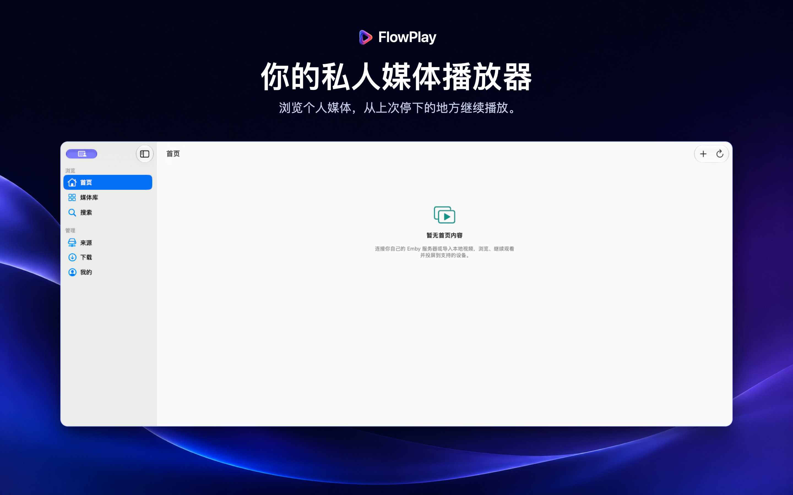
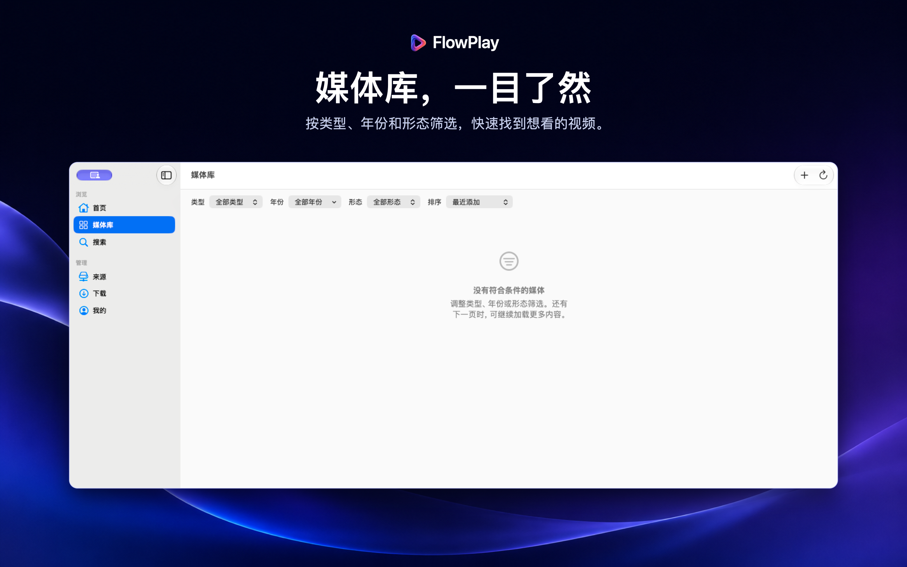
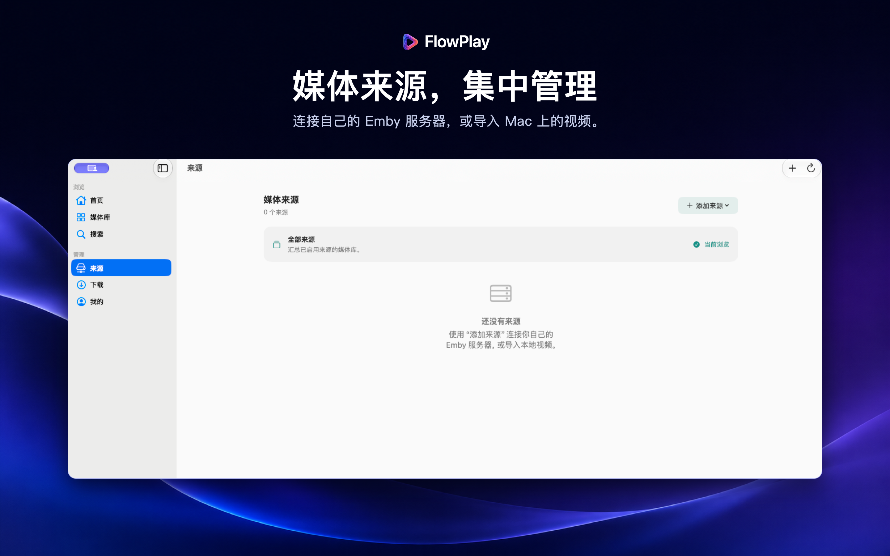

# FlowPlay

FlowPlay 是一款免费的私人媒体播放器，支持导入 Mac 上的视频、连接自己的 Emby 服务器，以及按类型、年份和形态筛选媒体库。

在 [GitHub Releases](https://github.com/heiyuan0801/FlowPlay/releases) 下载 macOS 安装包。需要 Apple Silicon Mac 和 macOS 14 或更高版本。安装包尚未经过 Apple 公证，macOS 默认可能阻止打开。

## macOS 截图

FlowPlay 使用按 LGPL 2.1 或更新版本许可分发的 [FFmpeg](https://ffmpeg.org/)。对应源码和构建脚本随 [Release](https://github.com/heiyuan0801/FlowPlay/releases) 提供。
